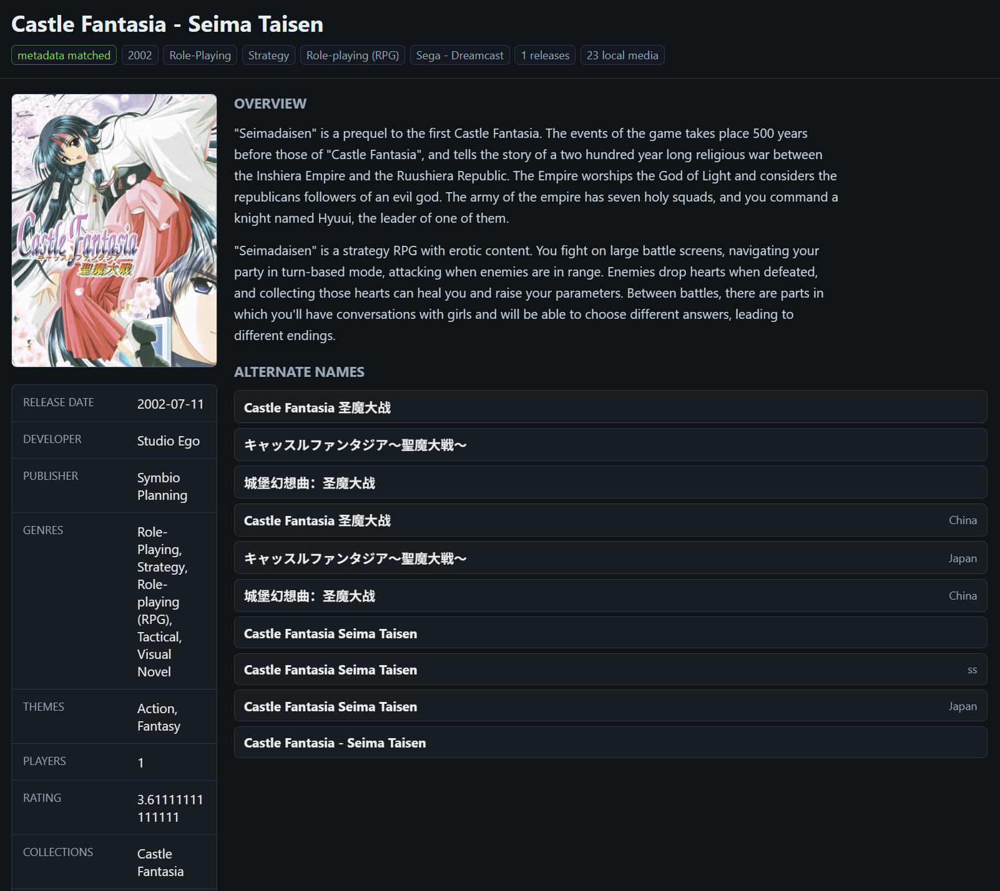

# RomMeta

RomMeta prepares a local metadata catalog for ROM collections. Import DAT release
and checksum data, fetch provider metadata and artwork, review regional game
bundles, then generate frontend metadata from the prepared catalog locally or over
your network.
Catalog data stays in readable YAML with source evidence and explicit overrides.
Prepared [translations and hacks](docs/catalog-variants.md) can inherit metadata
from their original game, with an optional exact release, while retaining their
own fingerprints.



**0.2.0 is pre-stable.** Command names and catalog formats may change before 1.0.
RomMeta includes no ROMs, BIOS, provider database or downloaded artwork.

## Catalog inputs

| Catalog | Supported input |
| --- | --- |
| No-Intro | XML DAT files, including DAT members in ZIP archives; release attributes and ROM checksums |
| Redump | XML DAT files, including DAT members in ZIP archives; disc releases and file checksums |
| [MAME](docs/arcade-import.md) | Official `listxml` XML/ZIP input with version-matched classifications, set components and parent/clone relationships |
| [Private gamelists](docs/gamelist-import.md) | ES-DE/EmulationStation XML or ZIP packs with referenced media; enrichment of existing catalog releases |
| [ScummVM](docs/scummvm.md) | Structured official game list imported as game cards; no DAT or game files required |

## Metadata and media sources

These providers enrich catalog cards through `fetch`:

| Source | Fetch types |
| --- | --- |
| LaunchBox | `metadata`, `artwork` |
| OpenVGDB | `metadata`, `artwork` |
| IGDB | `metadata`, `artwork` |
| ScreenScraper | `metadata`, `artwork` |
| Hasheous | `metadata`, using ROM identity |
| EmuMovies | `artwork`, `video` |

See [source setup](docs/source-setup.md) for accounts/credentials and
[fetch selection](docs/fetch.md) for platform applicability and matching.

## Export targets

| Target | Integration | Output |
| --- | --- | --- |
| ES-DE | Built-in [export --target es-de](docs/frontend-export.md), local or over API | Direct creation/enrichment of gamelists and media; optional portable package |
| LaunchBox | Built-in [export --target launchbox](docs/launchbox-export.md), local or over API | Direct creation/enrichment of cards, versions and media; optional portable package |
| RomM | Separate [server importer example](examples/romm-importer/README.md) | Metadata and media for already-scanned games in the pinned RomM runtime |

Catalog platforms use [generic ROM-set export](docs/romset-export.md), including
new headers without code registration. IBM PC and ScummVM remain explicit export
exclusions. See [input formats and scenarios](docs/export-scenarios.md).
The [HTTP API](#http-api) also exposes catalog data and assets to other consumers.

## Install

For the main CLI, choose a `rommeta-<version>-<os>-<arch>.zip` Windows **amd64**
or Linux **amd64/arm64** archive from
[Releases](https://github.com/divanikus/rom-meta/releases) and verify `SHA256SUMS`.
On Linux, run `chmod +x ./rom-meta`. Add the executable's directory to `PATH`.
Check installation with `rom-meta --version` and `rom-meta --help`.

Release builds also produce separate `prepare-variants-<version>-<os>-<arch>.zip`
assets for the standalone [translation preparation helper](docs/prepare-variants.md).
Choose that asset when you need to prepare variant links; it runs without Go.

To build from source, use the Go version in [go.mod](go.mod):

```shell
git clone https://github.com/divanikus/rom-meta.git
cd rom-meta
go build -o bin/rom-meta ./cmd/rom-meta
```

On Windows use `-o bin/rom-meta.exe`. Prebuilt binaries do not require Go.

If you already have a prepared catalog, go directly to [frontend export](#export-to-a-frontend).
DAT imports and provider accounts are needed to prepare or extend the catalog,
not to export from an existing local library.

## Import, enrich and review

Keep the catalog outside the source checkout and ROM directories. Replace example
paths with your own; start with one platform and a small sample.

```shell
rom-meta init "/path/to/catalog"
rom-meta dat plan "/path/to/platform.dat-or-zip"
rom-meta dat import "/path/to/platform.dat-or-zip" --data-root "/path/to/catalog"
rom-meta dat import "/path/to/platform.dat-or-zip" --data-root "/path/to/catalog" --apply
rom-meta sources list --data-root "/path/to/catalog"
```

Follow [source setup](docs/source-setup.md) for accounts/credentials and
`config/sources.yaml`. Then preview enrichment, apply and review folds:

```shell
rom-meta fetch --data-root "/path/to/catalog" --platform gamegear --source launchbox --type metadata --limit 10
rom-meta fetch --data-root "/path/to/catalog" --platform gamegear --source launchbox --type metadata --limit 10 --apply
rom-meta catalog fold --data-root "/path/to/catalog" --platform gamegear --details
rom-meta catalog fold --data-root "/path/to/catalog" --platform gamegear --interactive
rom-meta validate "/path/to/catalog"
```

Repeat fetch to resume; run catalog writers sequentially. See the
[operator workflow](docs/cli-workflow.md) for recovery and review, or
`rom-meta help <command>` for flags.

## Browse

```shell
rom-meta serve --data-root "/path/to/catalog"
```

Open http://127.0.0.1:8787 for the read-only browser. Local browsing requires no
token or profile. Stats starts with one platform; full-catalog scans are explicit,
show progress and support cancellation. HDD/network scans can take minutes.
Video loads on playback. The ordinary view includes saved game fields and source
evidence. Enable **Export view** to adjust one shared frontend/language/media
profile while browsing, then **Save profile** to download YAML for CLI export.
Advanced preferences stay collapsed; no catalog/frontend writes occur in the web
UI. See [the browser guide](docs/catalog-api.md#browse-with-an-export-profile).

## HTTP API

The same `serve` exposes catalog metadata and media:

| Route | Purpose |
| --- | --- |
| `/api` | Endpoint index and browser API |
| `/v1/*` | Consumer lookup, export and assets |
| `/docs` | Interactive Swagger UI |
| `/openapi.json` | OpenAPI specification |

[API reference](docs/catalog-api.md) covers schemas and optional shared-token access.

## Export to a frontend

ES-DE and LaunchBox use the same [export/enrichment interface](docs/frontend-export.md):

```shell
rom-meta export --target es-de --platform nes --data-root "/path/to/catalog" --rom-root "/path/to/roms/nes" --destination "/home/player/ES-DE"
rom-meta export --target launchbox --platform nes --data-root "D:\Catalog" --rom-root "D:\ROMs\nes" --destination "D:\LaunchBox"
```

Review recognition, coverage and destination changes, then repeat with `--apply`.
The command adds missing entries and fills empty metadata/media, preserving
favorites, statistics, emulator choices and existing nonempty fields. Close the
frontend before applying; replaced files are backed up automatically. ROMs and
the catalog remain unchanged. Preview does not copy or download media.

Use `--api "http://catalog-host:8787"` instead of `--data-root` for a remote catalog,
`--platforms`/`--all` for several systems (short or long folder names; see
[platform codes and discovery](docs/platform-selection.md)), and an optional `--profile` for language,
source and media priorities. To create a portable package, use `--out <new-directory>`
instead of `--destination`. Install a prepared package through the same command
with `--package <directory> --destination <frontend-directory>`.

See [ES-DE details](docs/offline-export.md), [LaunchBox versions/discs](docs/launchbox-export.md)
and [input formats](docs/export-scenarios.md).

**RomM:** the [server importer example](examples/romm-importer/README.md) fills
already-scanned games through native RomM 5.4.1 handlers and Resources. It requires
administrator setup and is version-specific and experimental; it remains a
separate server-side integration.

## Boundaries

- Preview catalog changes before `--apply` or interactive approval. Back up broad
  identity changes; advanced split/partition review uses hash-bound plans.
- Reports distinguish exact hashes, weaker names and game-only matches. CHD
  observations and MAME set names do not prove dump validity or gameplay.
- Unsupported formats and ambiguities are reported. ROM conversion/organization,
  emulator setup and additional frontend templates are outside the current scope.
- Provider terms still govern downloaded metadata/media and generated packages.

## Documentation and development

- [Documentation index](docs/README.md)
- [0.2.0 release notes](docs/releases/0.2.0.md)
- [Contributing and verification](CONTRIBUTING.md)

RomMeta code is licensed under [MIT](LICENSE). Third-party notices accompany
binary releases; vendored Swagger UI retains its own license and notices.
