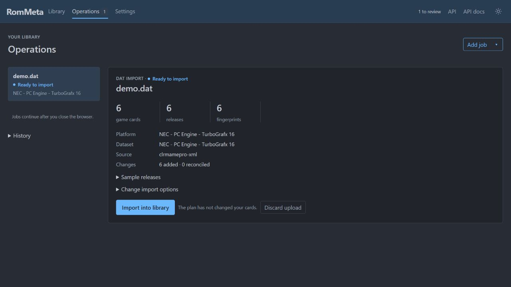
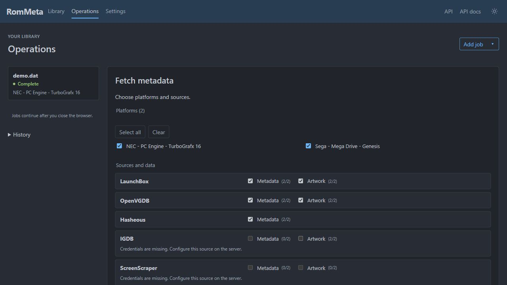
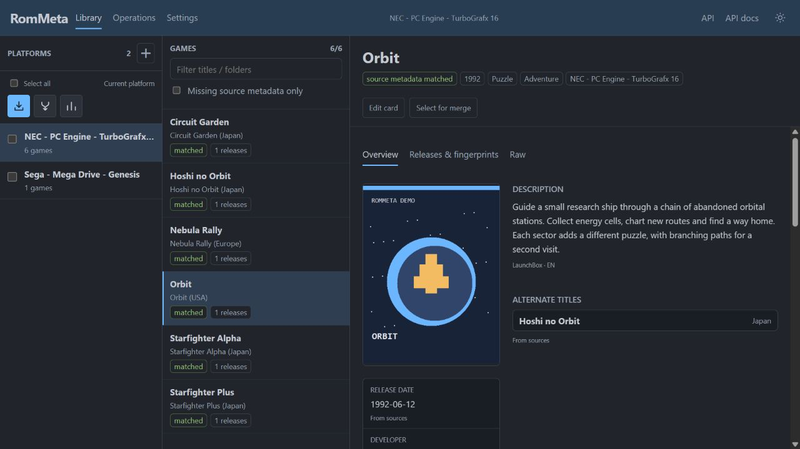
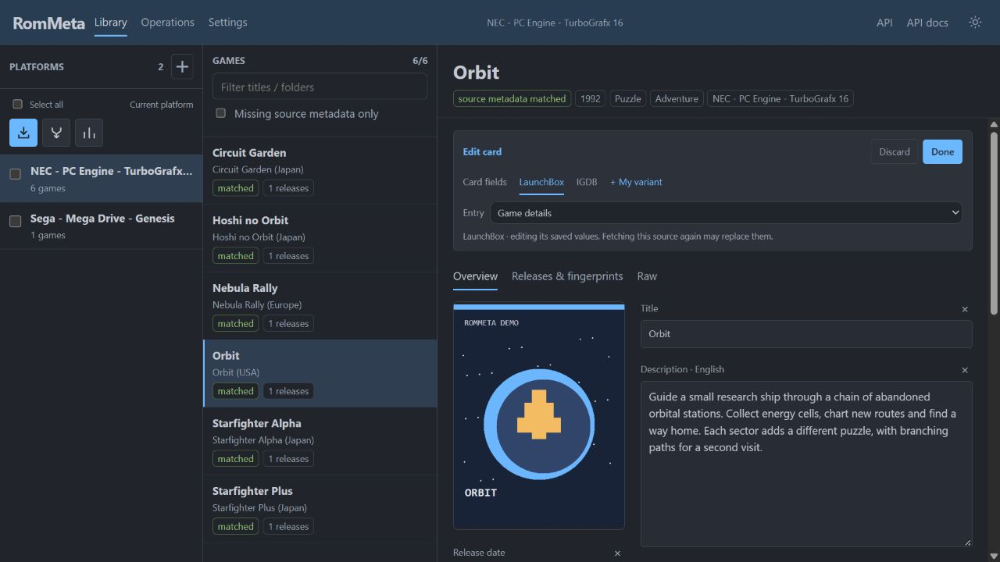
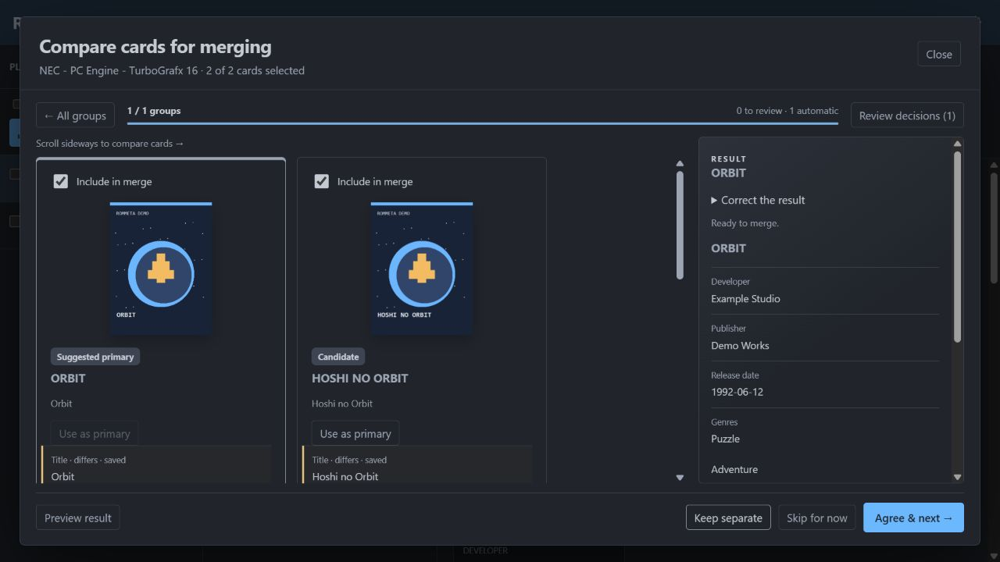
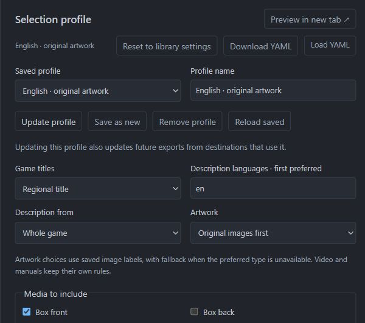
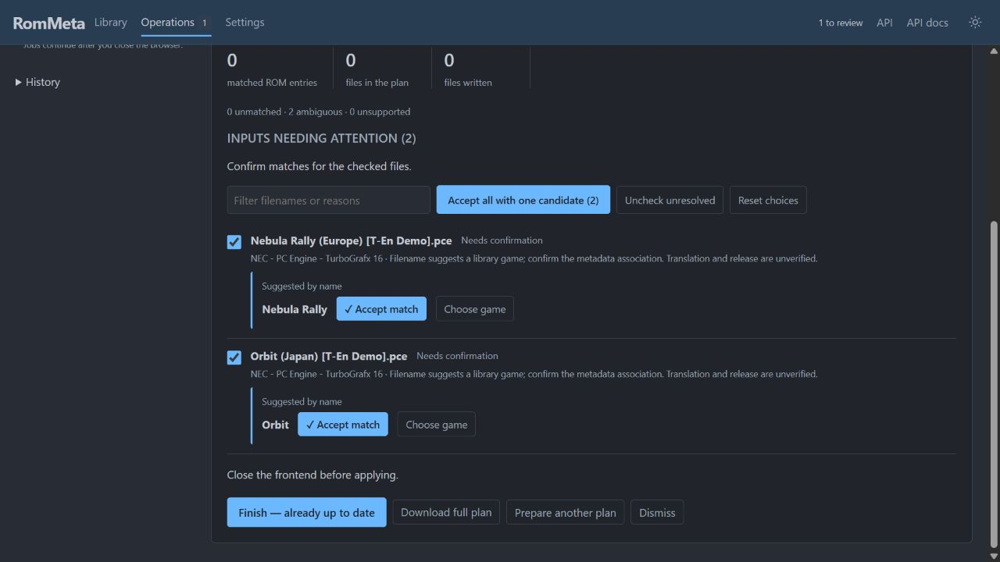

# From an empty library to a frontend export

These screenshots use a small synthetic library: the games, descriptions and
artwork are original demonstration data, not a downloadable ROM collection.

## Start and import

```shell
rom-meta init "/path/to/catalog"
rom-meta serve --data-root "/path/to/catalog" --edit
```

Open http://127.0.0.1:8787. Choose **Import your first DAT**, or **+** beside
Platforms in an existing library. Upload a DAT/ZIP, inspect the counts and choose
**Import into library**. Recommended DAT sources are linked in the upload form.



**Open platform** shows the imported cards. **Fetch metadata** on the completed
import takes you directly to source selection.

## Fetch metadata and artwork

Check several platforms in the sidebar, then choose **Fetch metadata**. Select
providers, data types and parallel workers; **Review tasks** prepares the job.
**Start** runs it immediately, or **Enqueue** waits for the current writer.
Missing credentials are explained beside the relevant source.



Operations shows each stage, its counts and outcome. Close and reopen the browser
to return to the same job. Failed stages offer Retry when supported. The server
must stay running; restarting it clears this operation history.

## Browse and edit

Select a game to see its cover, source descriptions, alternate titles and releases.
The tabs separate Overview, Releases & fingerprints and Raw.



**Edit card** turns those values into fields. Select a provider to edit its saved
record, or add a named manual variant for your own version. Enable that variant
in export source priorities. **Done** validates, saves and leaves editing;
**Discard** abandons the draft and leaves editing. Releases contain their linked
fingerprints, with add/edit/remove controls. Raw edits are validated too.



## Review duplicates

Select platforms and choose **Merge**. Ready groups are prepared automatically;
other groups explain the decisions or conflicts that remain. Open Compare to
inspect cards and the proposed result together. **Agree & next** or **Keep separate**
collects a decision; the counter and progress bar track your review.



**Review decisions** leads to the final batch Apply. Nothing is merged while you
browse candidates. Retaining a backup is optional and off by default. Related
ports or editions alone do not prove that two cards are the same game.

## Choose export settings

Open **Operations → Add job → Export**. Choose ES-DE or LaunchBox, a destination
folder and your ROM folder. These paths belong to the machine running `serve`.
Save a named destination if you want to reuse it.

Configure the profile in the same form: title style, description languages,
original/reconstructed artwork, media types and source priorities. **Save profile**
keeps a named version in the library. **Preview in new tab** lets you inspect it
without losing the export setup. Saved profiles and destinations also work in the
[CLI](frontend-export.md#saved-profiles-and-destinations).



## Review and apply

**Prepare export plan** scans the selected ROMs and calculates native changes.
The review focuses on inputs needing attention. Confirm name suggestions, choose
a different library game, or uncheck files to exclude them. **Accept all with one
candidate** handles unique suggestions in one action; ambiguous choices remain
for individual review. A name match selects metadata, not a verified translation
or release.



Review works even with zero recognized games. After changing choices, choose
**Update export plan**, inspect the result, then **Apply export**. Updating the
plan writes nothing. Excluding every input produces a no-op plan. Export preserves
ROMs and catalog data; native writes follow the additive rules in the
[frontend export guide](frontend-export.md).

For the complete controls and limitations, see [library management](catalog-editing.md).
